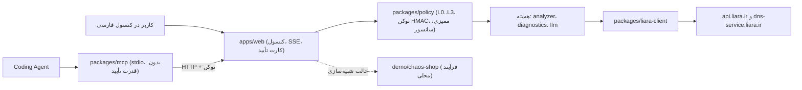

# سُکان — همکار DevOps/SRE برای لیارا

> **English summary.** Sokan is a DevOps/SRE assistant for apps hosted on Liara. It analyzes a Node, Next, Python, PHP, Go or Docker project, recommends a plan, deploys, reads logs, metrics and HTTP probes, diagnoses failures, and asks for explicit approval before any change. Approvals are bound to the exact parameters and checked on the server. The repo is a TypeScript monorepo with a Persian web console, a stdio MCP server for coding agents, and a demo target app (`chaos-shop`). Live Liara calls need `LIARA_API_TOKEN`. Without it, actions run against a local simulated target. The implementation status is listed honestly below.

<div dir="rtl">

🎬 ویدئوی دمو: <لینک پس از ضبط>

## چه می‌کند

«سُکان» یک دستیار فارسی‌زبان برای استقرار و عارضه‌یابی اپلیکیشن‌های روی لیارا است. اپ شما را تحلیل می‌کند، پلن مناسب پیشنهاد می‌دهد و استقرار را انجام می‌دهد. سپس لاگ، متریک و پاسخ HTTP را می‌خواند و علت خطا را با شواهد توضیح می‌دهد.

هر تغییر حساس فقط با کارت تأیید صریح کاربر اجرا می‌شود. پارامترهای کارت با اجرا یکی است، و پس از اجرا وضعیت قبل و بعد مقایسه می‌شود. این مقایسه نتیجه‌ی «حل شد» یا «حل نشد» را تعیین می‌کند.

> این بخش هدف محصول را توصیف می‌کند. وضعیت هر قابلیت در جدول «وضعیت پیاده‌سازی» آمده است.

## اجرای سریع

پیش‌نیاز: Node.js نسخه‌ی ۲۲ (یا ۲۰ به بالا).

```bash
npm install     # نصب وابستگی‌ها
npm test        # بیلد TypeScript و اجرای تست‌ها
npm start       # بیلد و اجرای کنسول وب سُکان
```

- سُکان آدرسی شبیه `http://127.0.0.1:4000/?t=<token>` چاپ می‌کند. آن را در مرورگر باز کنید. اگر `SOKAN_CONSOLE_TOKEN` تنظیم نشده باشد، توکن تصادفی ساخته و در ترمینال چاپ می‌شود.
- حالت زنده: `LIARA_API_TOKEN` و `SOKAN_APP` (نام اپلیکیشن) را تنظیم کنید. بدون توکن، همه‌ی اقدامات روی اپ دمو محلی `chaos-shop` اجرا می‌شوند و پیام‌هایشان با «(شبیه‌سازی محلی)» شروع می‌شود.
- گفت‌وگوی مبتنی بر LLM: `SOKAN_LLM_API_KEY`، `SOKAN_LLM_BASE_URL` (پیش‌فرض `https://agentrouter.org/v1`) و `SOKAN_LLM_MODEL`. بدون کلید، گفت‌وگو قاعده‌محور است.
- فهرست همه‌ی متغیرها در `.env.example` است. سُکان فایل `.env` را خودکار نمی‌خواند؛ مثلاً با `node --env-file=.env apps/web/server.js` اجرا کنید.

> **یادداشت وضعیت:** کنسول فعلی هنوز روی `0.0.0.0` گوش می‌دهد و توکن را اعمال نمی‌کند. تنظیم `127.0.0.1` و توکن ورود در جدول وضعیت به‌عنوان «در حال انجام» ثبت شده است.

## معماری کوتاه



| بسته یا پوشه | مسئولیت | وضعیت |
|---|---|---|
| `packages/contracts` | نوع‌های مشترک: کارت تأیید، Incident، FixBrief، تعریف ابزارها | پیاده‌شده |
| `packages/policy` | سطوح ریسک L0 تا L3، توکن HMAC یک‌بارمصرف گره‌خورده به پارامترها، ممیزی زنجیره‌ای، سانسور راز | پیاده‌شده (کتابخانه) |
| `packages/analyzer` | تحلیل پروژه (Node، Next، Python، PHP، Go، Docker)، تشخیص پورت و متغیرها، پیشنهاد سه پلن | پیاده‌شده (کتابخانه) |
| `packages/diagnostics` | پارس لاگ و stack trace، ۱۵ runbook، امتیازدهی فرضیه‌ها، Fix Brief، راستی‌آزمایی قبل و بعد | پیاده‌شده (کتابخانه) |
| `packages/liara-client` | کلاینت تایپ‌شده‌ی API لیارا، بسته‌بندی سورس، ترجمه‌ی خطای HTTP به پیام سه‌بخشی | پیاده‌شده (کتابخانه) |
| `packages/llm` | کلاینت مدل زبانی سازگار با OpenAI، ارکستریتور tool-calling، مسیریاب قاعده‌محور | پیاده‌شده (کتابخانه) |
| `packages/mcp` | سرور MCP روی stdio برای Coding Agentها. L2 و L3 فقط درخواست تأیید می‌سازند | پیاده‌شده (کنسول هنوز `/api/tools` ندارد) |
| `apps/web` | کنسول وب فارسی، رویدادهای SSE، کارت‌های تأیید، تب سناریوهای دمو | شبیه‌سازی محلی |
| `demo/chaos-shop` | اپ دمو با ۶ حالت خرابی قابل‌کنترل از طریق متغیر محیطی | پیاده‌شده |

## اتصال به APIهای لیارا

- **احراز هویت:** هدر `Authorization: Bearer <LIARA_API_TOKEN>`. اگر `LIARA_TEAM_ID` تنظیم شده باشد، به‌صورت پارامتر `teamID` افزوده می‌شود.
- **پایه‌ی آدرس:** `https://api.liara.ir` برای اپ‌ها و `https://dns-service.liara.ir` برای DNS.
- **حالت زنده:** وقتی `LIARA_API_TOKEN` باشد، کلاینت درخواست واقعی می‌فرستد. بدون توکن، کلاینت هیچ درخواستی نمی‌فرستد و خطای «حالت شبیه‌سازی» برمی‌گرداند.
- **حالت شبیه‌سازی:** اپ `chaos-shop` به‌عنوان فرآیند محلی روی پورت `CHAOS_PORT` (پیش‌فرض ۳۱۰۰) اجرا می‌شود. لاگ، پروب HTTP و حافظه از همین فرآیند خوانده می‌شود، نه از API لیارا.

| endpoint لیارا | ابزار سُکان | ریسک | منبع | وضعیت |
|---|---|---|---|---|
| `GET /v1/me`، `GET /v1/billing` | `account_status` | L0 | OpenAPI | در کلاینت |
| `GET /v1/projects/{name}` | `app_status` | L0 | OpenAPI | در کلاینت |
| `POST /v1/projects` | بخشی از `deploy` | L2 | OpenAPI + CLI | در کلاینت |
| `POST /v2/projects/{name}/sources` | بخشی از `deploy` | L1 | OpenAPI + CLI | در کلاینت |
| `POST /v2/projects/{name}/releases` | `deploy`، `release_rollback` | L2 | OpenAPI + CLI | در کلاینت |
| `GET /v2/releases/{id}/build-logs` | پایش بیلد در `deploy` | L0 | CLI | در کلاینت (فقط CLI) |
| `POST /v1/projects/{name}/actions/restart` | `app_restart` | L2 | OpenAPI | در کلاینت |
| `POST /v1/projects/{name}/actions/scale` | `app_scale` | L2؛ L3 اگر `scale=0` | OpenAPI | در کلاینت |
| `POST /v1/projects/{name}/resize` | `app_resize_plan` | L2 | OpenAPI | در کلاینت |
| `POST /v1/projects/update-envs` | `app_update_envs` | L2 | OpenAPI | در کلاینت |
| `POST /v1/projects/update-port` | `app_update_port` | L2 | CLI | در کلاینت (فقط CLI) |
| `GET /v1/projects/{name}/logs` | `sre_investigate` | L0 | OpenAPI | در کلاینت |
| `GET .../applets`، `.../metrics/summary`، `.../metrics/{cpu\|memory}`، `.../events` | `sre_investigate` | L0 | OpenAPI | در کلاینت |
| `DELETE /v1/projects/{name}` | `app_delete` | L3 | OpenAPI | در کلاینت |
| `/v1/domains`، `dns-service /api/v1/zones` | `domain_connect_guide` و ابزارهای دامنه | L0 تا L2 | OpenAPI | در کلاینت |

جدول کامل endpointها و کدهای خطا در [`packages/liara-client/docs/api-matrix.md`](packages/liara-client/docs/api-matrix.md) آمده است. «در کلاینت» یعنی متد تایپ‌شده وجود دارد و در تست‌های واحد بررسی شده است. هنوز هیچ‌کدام از کنسول با توکن زنده صدا زده نمی‌شوند.

## تعامل کاربر

**نمونه‌ی گفت‌وگوی هدف** (این گفت‌وگو هنوز در کنسول زنده نیست):

> **کاربر:** سایتم ۵۰۰ می‌دهد، ببین چرا.
>
> **سُکان:** اپ `chaos-shop` روی `/api/items` خطای ۵۰۰ می‌دهد. شواهد: خطای `PrismaClientInitializationError` در لاگ و پاسخ ۵۰۰ در پروب HTTP. متغیر `DATABASE_URL` تنظیم نشده است (`src/db/client.js:24`). پیشنهاد: تنظیم `DATABASE_URL` و ری‌استارت اپ. کارت تأیید را ببینید.

**کارت تأیید** (شش فیلد استاندارد، §۱۲.۲ وایت‌پیپر):

| فیلد | نمونه |
|---|---|
| چه کاری | تنظیم متغیر `DATABASE_URL` و ری‌استارت `chaos-shop` |
| چرا | ۵ پاسخ ۵۰۰ با خطای اتصال به دیتابیس در لاگ |
| هزینه | بدون هزینه |
| اثر | حدود ۱۰ ثانیه قطع کوتاه هنگام ری‌استارت |
| بازگشت | حذف متغیر یا برگرداندن مقدار قبلی و ری‌استارت |
| معیار موفقیت | `/api/items` کد ۲۰۰ بدهد و `/health` سالم بماند |

**سطوح ریسک:**

| سطح | معنی | نمونه‌ی ابزار (از `packages/llm/src/tools.ts` و `packages/policy/src/engine.ts`) |
|---|---|---|
| L0 | مشاهده؛ بدون کارت | `project_analyze`، `app_status`، `sre_investigate`، `limits_list`، `billing_get_balance` |
| L1 | ایمن و برگشت‌پذیر؛ اجرا و ثبت در زمان‌خط | `source_upload`، `release_cancel`، `domain_add`، `domain_enable_ssl`، `db_backup_create` |
| L2 | حساس؛ کارت تأیید و توکن امضاشده‌ی سرور | `app_restart`، `app_update_envs`، `app_resize_plan`، `app_update_port`، `app_scale` (روشن)، `deploy`، `release_rollback` |
| L3 | بحرانی؛ تایپ نام دقیق اپ و پنجره‌ی لغو ۱۰ ثانیه‌ای | `app_delete`، `app_scale` با `scale=0` |

تأیید در سمت سرور بررسی می‌شود. توکن به هش پارامترها گره خورده، پنج دقیقه اعتبار دارد و فقط یک بار مصرف می‌شود. اگر پارامترها بین کارت و اجرا تغییر کنند، اجرا رد می‌شود.

## استفاده از MCP با Claude Code

سرور MCP روی stdio اجرا می‌شود و هیچ قدرت تأیید ندارد. ابزارهای L2 و L3 فقط یک درخواست تأیید با آدرس کنسول برمی‌گردانند.

```bash
npm run build
SOKAN_CONSOLE_URL=http://127.0.0.1:4000 SOKAN_CONSOLE_TOKEN=<توکن کنسول> node build/mcp/src/bin.js
```

نمونه‌ی `.mcp.json` برای Claude Code (مسیر را مطلق بگذارید):

```json
{
  "mcpServers": {
    "sokan": {
      "command": "node",
      "args": ["/absolute/path/to/sokan-liara/build/mcp/src/bin.js"],
      "env": {
        "SOKAN_CONSOLE_URL": "http://127.0.0.1:4000",
        "SOKAN_CONSOLE_TOKEN": "<توکن کنسول>"
      }
    }
  }
}
```

ابزارهای MCP همان ابزارهای ارکستریتور به‌علاوه‌ی `incident_get_fix_brief` (Fix Brief برای Coding Agent) و `approval_status` هستند. فراخوانی از MCP به `POST /api/tools/:name` کنسول می‌رود؛ این مسیر در کنسول فعلی هنوز پیاده‌سازی نشده است.

## محدودیت‌ها

منبع این جدول `packages/liara-client/src/limits.ts` است. همین متن‌ها به کاربر نمایش داده می‌شوند.

| قابلیت | محدودیت لیارا | راه‌حل سُکان |
|---|---|---|
| شارژ حساب و پرداخت | API عمومی برای شارژ وجود ندارد | محاسبه‌ی کسری موجودی، نمایش لینک کنسول و بررسی مجدد موجودی |
| تغییر NameServer در ایرنیک | ایرنیک API عمومی و احراز هویت‌شده ندارد | چک‌لیست با مقادیر قابل کپی و پایش انتشار NS از طریق Zone در سرویس DNS |
| اتصال اولیه‌ی GitHub | در OpenAPI فقط خواندن وضعیت اتصال هست | آپلود مستقیم سورس، یا تولید workflow برای GitHub Actions با `@liara/cli` |
| متریک سطح درخواست (p95 و خطای ۵xx) | API فقط CPU، حافظه، شبکه و دیسک می‌دهد | پروب HTTP مستقل و تحلیل لاگ‌های دسترسی |
| هشدار و Webhook بومی | اندپوینتی در OpenAPI دیده نشد | پایش دوره‌ای با متریک، رویدادها و پروب خارجی |
| Rollback با فراخوانی اختصاصی | اندپوینت جدا برای بازگشت وجود ندارد | ایجاد ریلیز جدید با منبع یا تصویر نسخه‌ی سالم قبلی؛ باید با تست زنده تأیید شود |

**شبیه‌سازی:** در حالت محلی، دیپلوی و تغییرات روی فرآیند `chaos-shop` انجام می‌شوند، نه روی لیارا. نتیجه‌های آن برای نمایش سناریوهاست و جای تست زنده را نمی‌گیرد.

**تأیید نشده با API زنده:** endpointهای `build-logs`، `GET /v1/releases/{id}`، `cancel` و `update-port` فقط در کد CLI رسمی دیده شده‌اند و در OpenAPI نیستند. مسیر `logs` در OpenAPI با `v1` و پارامتر `since` است، در حالی که CLI از `v2` با `start` استفاده می‌کند. هیچ‌یک از این‌ها با توکن زنده آزموده نشده‌اند.

## وضعیت پیاده‌سازی

| قابلیت | وضعیت | یادداشت |
|---|---|---|
| کلاینت API لیارا با خطای سه‌بخشی و retry فقط برای GET | پیاده‌شده | `packages/liara-client`، تست واحد دارد؛ تست زنده ندارد |
| بسته‌بندی سورس `.tar.gz` (حذف `node_modules`، `.git`، `.env*`) | پیاده‌شده | `packSource`؛ تست زنده ندارد |
| زنجیره‌ی deploy در کلاینت (سورس، ریلیز، پایش بیلد) | پیاده‌شده در کلاینت | از کنسول هنوز صدا زده نمی‌شود |
| سطوح ریسک، توکن HMAC یک‌بارمصرف، تایپ نام و پنجره‌ی لغو L3 | پیاده‌شده | `packages/policy` |
| ممیزی زنجیره‌ای HMAC و ذخیره‌ی روی فایل | پیاده‌شده | `AuditLedger` با `filePath`؛ کلید از `SOKAN_SECRET` |
| سانسور راز (Redactor) | پیاده‌شده | `packages/policy`؛ هنوز روی همه‌ی خروجی‌های کنسول اعمال نشده |
| تحلیل پروژه و پیشنهاد سه پلن | پیاده‌شده | `packages/analyzer` |
| پارس لاگ، ۱۵ runbook، امتیازدهی، Fix Brief | پیاده‌شده | `packages/diagnostics` |
| راستی‌آزمایی قبل و بعد از اقدام | پیاده‌شده | `takeSnapshot` و `verify`؛ کنسول هنوز آن‌ها را فراخوانی نمی‌کند |
| کلاینت LLM، tool-calling و مسیریاب | پیاده‌شده | `packages/llm`؛ کنسول هنوز به آن وصل نیست |
| سرور MCP روی stdio | پیاده‌شده | کارکرد کامل نیازمند `POST /api/tools/:name` در کنسول است |
| کنسول وب فارسی، SSE، کارت تأیید، تب سناریوهای دمو | شبیه‌سازی محلی | `apps/web` |
| اپ دمو با ۶ حالت خرابی | پیاده‌شده | `demo/chaos-shop`: نبود `DATABASE_URL`، نشت حافظه با OOM، CPU، upstream کند، N+1، پورت اشتباه |
| احراز هویت کنسول (توکن، Origin، CSRF، bind روی `127.0.0.1`) | در حال انجام | کد فعلی بدون توکن و روی `0.0.0.0` است |
| اجرای زنده‌ی اقدامات از کنسول (restart، envs، resize، deploy) | در حال انجام | کد فعلی متدهای کلاینت را صدا نمی‌زند |
| گفت‌وگوی LLM در کنسول | در حال انجام | بسته‌ی `packages/llm` آماده است |
| Health Watch زمان‌بندی‌شده | آینده | ساخته نشده |
| ویزارد گام‌به‌گام دامنه، ایرنیک و SSL | آینده | فقط متدهای کلاینت دامنه و DNS وجود دارد |
| اتصال GitHub از طریق سُکان | آینده | API فقط خواندن وضعیت را می‌دهد |
| Rollback اختصاصی | آینده | فعلاً فقط با ایجاد ریلیز جدید ممکن است و تأیید زنده ندارد |

## مستندات بیشتر

- [وایت‌پیپر طراحی](docs/WHITEPAPER-v1.md): هدف و قواعد طراحی.
- [مستندات معماری](docs/ARCHITECTURE.md): معماری و مرزهای سیستم.
- [گزارش داوری](docs/EVALUATION.md): ارزیابی مستقل نسخه‌ی قبلی و فهرست شکاف‌ها.
- [ماتریس APIهای لیارا](packages/liara-client/docs/api-matrix.md): نگاشت endpoint به ابزار و منبع.
- [پژوهش NotebookLM](research/README.md): ابزار آماده‌سازی پایگاه دانش (خارج از محصول).

</div>
