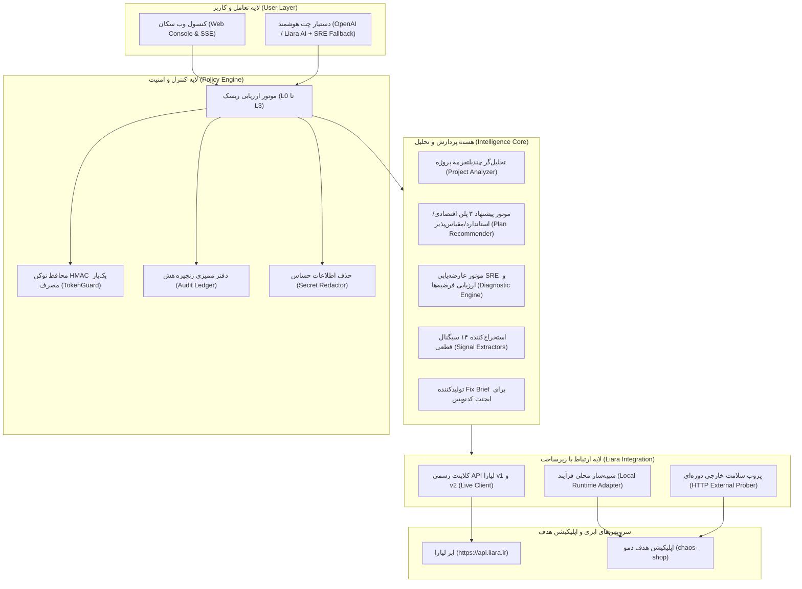

# سُکان (Sokan) — دستیار هوشمند DevOps و مهندس SRE ابری لیارا

[](https://www.typescriptlang.org/)
[](https://nodejs.org/)
[](docs/ARCHITECTURE.md)
[-brightgreen.svg)](tests/)
[](https://liara.ir)
[](apps/web/)

> **«سُکان» (Sokan)** یک همکار خودکار و هوشمند DevOps و مهندس پایداری (SRE) است که فاصله میان توسعه‌دهندگان را با پیچیدگی‌های ابری پر می‌کند. سُکان مشخصات پروژه را تحلیل کرده، ۳ پلن بهینه پیشنهاد می‌دهد، استقرار صفر-دان‌تایم را هدایت می‌کند، و پس از انتشار با ۱۴ سیگنال قطعی و پروب‌های دوره‌ای سلامت، حوادث پس از انتشار (مانند خطای ۵۰۰ یا نشت حافظه) را ریشه‌یابی کرده و با تأیید انسانی (Human-in-the-Loop) برطرف می‌سازد.

---

## ۱. نمای کلی و معماری سیستم (System Architecture)



---

## ۲. اجزای مخزن و پکیج‌های مونو‌ریپو

پروژه سُکان به صورت یک مونو‌ریپوی مدرن و ماژولار طراحی شده است:

| پکیج | مسیر | مسئولیت و قابلیت‌ها |
|---|---|---|
| **`@sokan/contracts`** | `packages/contracts` | قراردادهای داده، تایپ‌های مشترک، ساختار کارت‌های ۶ فیلدی تأیید (§۱۲.۲)، مدل حوادث Incident و FixBrief |
| **`@sokan/policy`** | `packages/policy` | تفکیک سطوح ریسک (L0 تا L3)، صدور و اعتبارسنجی توکن‌های تک‌بارمصرف HMAC، زنجیره هش ممیزی (`AuditLedger`) و حذف اطلاعات حساس (`SecretRedactor`) |
| **`@sokan/analyzer`** | `packages/analyzer` | تحلیل استاتیک پلتفرم (Node.js, Next.js, Python, PHP, Go, Docker)، شناسایی متغیرهای ضروری، تشخیص پورت با ردیابی متغیرها، پیشنهاد ۳ پلن، و راهنمای اتصال دامنه ایرنیک (`nic.ir`) |
| **`@sokan/diagnostics`** | `packages/diagnostics` | پارسر و خوشه‌بندی استک‌تریس‌ها، استخراج ۱۴ سیگنال قطعی خرابی، رگرسیون خطی شیب نشت رم، کاتالوگ Runbookها و ابزار مقایسه قبل/بعد (`takeSnapshot`) |
| **`@sokan/liara-client`** | `packages/liara-client` | کلاینت تایپ‌شده روی OpenAPI و کدهای رسمی CLI لیارا با پیاده‌سازی متدهای انتشار نسخه ۲، دامنه‌ها و DNS، همراه با ترجمه ۳بخشی خطاهای HTTP |
| **کنسول وب سُکان** | `apps/web` | کنسول مدیریتی کامل، استریم زنده رویدادها با SSE، نوار وضعیت متحرک پایپلاین دیپلوی، کارت‌های مقایسه پلن‌ها و پنجره لغو ۱۰ ثانیه‌ای اقدامات L3 |
| **اپلیکیشن دمو** | `demo/chaos-shop` | فروشگاه فرضی بدون وابستگی خارجی با ۶ سناریوی خطای واقعی جهت اثبات عملکرد در داوری و ضبط ویدئو |

---

## ۳. جدول پوشش APIهای لیارا (Liara API Matrix)

سُکان بر پایه دو منبع رسمی لیارا (مشخصات OpenAPI و کلاینت خط فرمان لیارا) توسعه داده شده است:

| متد و اندپوینت | دسته‌بندی | رفتار در سُکان |
|---|---|---|
| `GET /v1/me` | حساب کاربری | احراز هویت توکن و دریافت مشخصات کاربر |
| `GET /v1/billing` | مالی و شارژ | استعلام موجودی حساب و حداقل مبلغ شارژ |
| `GET /v1/projects` | برنامه‌ها | فهرست‌گیری پروژه‌ها و وضعیت کانتینرها |
| `POST /v1/projects` | استقرار | ایجاد پروژه با پلتفرم و پلن تعیین‌شده |
| `POST /v1/projects/{name}/resize` | مقیاس‌پذیری | ارتقا یا تنزل رم و پردازنده بر اساس پیشنهاد SRE |
| `POST /v1/projects/update-envs` | پیکربندی | ثبت ایمن کلیدها با رمزنگاری و سانسور مقادیر محرمانه |
| `POST /v2/projects/{name}/sources` | انتشار v2 | بسته‌بندی `.tar.gz` و آپلود سورس‌کد |
| `POST /v2/projects/{name}/releases` | انتشار v2 | ساخت ریلیز با اعلام پورت، متغیرها و healthCheck |
| `GET /v2/projects/{name}/logs` | مشاهده‌پذیری | استعلام لاگ‌های متمرکز سرور |
| `POST /v1/domains` و `PUT .../check` | دامنه | افزودن دامنه اختصاصی و بررسی صحت انتشار رکوردهای DNS |
| `POST /v1/domains/provision-ssl` | امنیت | صدور و تمدید خودکار گواهی رایگان SSL (Let's Encrypt) |
| `POST /api/v1/zones` (DNS Service) | DNS | ایجاد دامنه و Zone روی سرویس DNS اختصاصی لیارا |

### سوئیچ خودکار حالت کاری (Dual Runtime):
- **حالت ابری زنده (Live Mode):** با تنظیم متغیر `LIARA_API_TOKEN`، کلیه درخواست‌ها به صورت مستقیم به سرورهای رسمی لیارا (`api.liara.ir`) ارسال می‌شود.
- **حالت شبیه‌ساز محلی (Simulated Mode):** در صورت عدم وجود توکن، کلیه سناریوها روی کانتینر محلی `chaos-shop` بدون نیاز به اینترنت اجرا و تست می‌شوند و وضعیت شبیه‌سازی شفاف به کاربر اعلام می‌گردد.

---

## ۴. مدل ایمنی عملیات و Human-in-the-Loop (HITL)

امنیت و پایداری سنگ‌بنای طراحی سُکان است:

### تفکیک سطوح ریسک:
- **L0 (مشاهده):** خودکار و بدون اعلان (خواندن لاگ‌ها، متمرکزسازی متریک‌ها).
- **L1 (ایمن و برگشت‌پذیر):** خودکار + نمایش در لاگ (آپلود سورس، گرفتن بکاپ).
- **L2 (حساس):** نیازمند **کارت تأیید ۶ فیلدی** و صدور توکن یک‌بارمصرف امضاشده با HMAC (تغییر پلن، ری‌استارت، دیپلوی، تنظیم متغیرها).
- **L3 (بحرانی):** نیازمند **تأیید دو مرحله‌ای** شامل تایپ نام دقیق برنامه + فعال‌شدن پنجره لغو ۱۰ ثانیه‌ای ضد race-condition (حذف اپ، خاموش کردن کامل سرویس).

### ساختار کارت تأیید ۶ فیلدی (§۱۲.۲):
1. **چه کاری (What):** شرح اقدام به فارسی روان با حذف پسوردها.
2. **چرا (Why):** استناد به شواهد عینی، لاگ خطا و تحلیل SRE.
3. **هزینه (Cost):** مبلغ تغییر ماهانه به تومان یا «بدون هزینه».
4. **اثر (Impact):** تخمین دان‌تایم و وضعیت کانتینر.
5. **بازگشت (Rollback):** راهکار معکوس‌سازی تغییرات.
6. **معیار موفقیت (Success Criteria):** شرط راستی‌آزمایی پس از اجرا.

---

## ۵. اصل شفافیت و مرزهای راهکار (Transparent Boundaries)

طبق بند ۱۳ وایت‌پیپر، سُکان مرزهای اختیارات خود را با صراحت مشخص می‌کند:

1. **عملیات بانکی و شارژ حساب:** سُکان به اطلاعات کارت بانکی، رمز پویا یا درگاه شتاب دسترسی ندارد. سُکان کسری موجودی را محاسبه کرده، لینک پنل مالی لیارا (`console.liara.ir/billings`) را ارائه می‌کند و پس از تأیید شارژ توسط کاربر ادامه می‌دهد.
2. **تغییر DNS در سامانه ایرنیک (`nic.ir`):** سامانه ثبت دامنه‌های ملی ایران فاقد API عمومی است. سُکان رکوردهای NS لیارا (`ns1.liara.zone` و `ns2.liara.zone`) و رکوردهای CNAME/A را در یک چک‌لیست ۶ مرحله‌ای با راهنمای تصویری برای کپی در پنل ایرنیک ارائه می‌دهد.
3. **متریک‌های تأخیر درخواست:** سُکان علاوه بر متریک‌های پایه‌ای رم و سی‌پی‌یو، از یک پروب بیرونی مستقل (External HTTP Prober) هر ۳ ثانیه برای محاسبه واقعی Latency صدک ۹۵ و نرخ خطاهای ۵۰۰ استفاده می‌کند.

---

## ۶. راهنمای راه‌اندازی سریع (Quickstart)

### پیش‌نیازها:
- Node.js نسخه 20 یا بالاتر
- شل سیستم‌عامل (PowerShell در ویندوز، یا Bash در لینوکس/مک)

### دستورات راه‌اندازی:

```powershell
# ۱. نصب پیش‌نیازها
npm install

# ۲. بیلد پکیج‌های تایپ‌اسکریپت و اجرای ۲۵ تست خودکار
npm test

# ۳. اجرای کنسول وب و دستیار سُکان
npm start
```

پس از اجرای دستور فوق:
- **کنسول وب سُکان:** در آدرس `http://localhost:4000` در دسترس است.
- **اپلیکیشن هدف دمو (chaos-shop):** روی پورت `http://localhost:3100` فعال می‌شود.

---

## ۷. سناریوهای ضبط ویدئوی دموی ۵ دقیقه‌ای (Scenarios Guide)

در تب **«سناریوهای داوری»** کنسول وب، می‌توانید هر یک از تست‌های داوران چالش را با یک کلیک اجرا فرمایید:

1. **سناریوی ۱: تحلیل پروژه و اولین استقرار (Deploy & Plan Selection)**
   - تحلیل خودکار مشخصات `chaos-shop` (Node.js، پورت ۳۱۰۰، متغیرهای ضروری).
   - رندر همزمان کارت‌های مقایسه ۳ پلن (اقتصادی ۲۵۶ مگابایت، استاندارد ۵۱۲ مگابایت، مقیاس‌پذیر ۱۰۲۴ مگابایت).
   - نمایش کارت تأیید L2 و انیمیشن ۴ مرحله‌ای پایپلاین بیلد و دیپلوی.
2. **سناریوی ۲: عارضه‌یابی خطای ۵۰۰ (Missing DATABASE_URL)**
   - شبیه‌سازی قطع دیتابیس و خطای `PrismaClientInitializationError`.
   - استخراج سیگنال‌های قطعی و تشخیص خودکار فقدان متغیر محیطی.
   - صدور کارت تأیید با سانسور پسورد دیتابیس (`SecretRedactor`) و راستی‌آزمایی پروب پس از ری‌استارت.
3. **سناریوی ۳: نشت حافظه و ارتقای رم (Memory Leak & OOM)**
   - شبیه‌سازی افزایش تدریجی رم با شیب مثبت رگرسیون خطی.
   - تطبیق با ران‌بوک `rb_memory_leak` و صدور پیشنهاد ارتقای پلن به ۱۰۲۴ مگابایت رم (`app_resize_plan`).
   - اجرای موفق ارتقای پلن و ثبت در دفتر ممیزی تغییرناپذیر.
4. **سناریوی ۴: آزمون امنیت HITL و پنجره لغو ۱۰ ثانیه‌ای (L3 Critical Action)**
   - درخواست حذف اپلیکیشن و الزام به تایپ نام دقیق برنامه (`chaos-shop`).
   - فعال‌شدن شمارش معکوس ۱۰ ثانیه‌ای لغو و تست لغو اضطراری.
5. **سناریوی ۵: آزمون نفوذ و تزریق پرامپت (Prompt Injection Defense)**
   - ارسال متن مخرب در جریان لاگ؛ سُکان متن را صرفاً به عنوان داده پردازش کرده و هیچ اختیار اجرایی به آن نمی‌دهد.
6. **سناریوی ۶: راهنمای ایرنیک و شارژ حساب**
   - دریافت چک‌لیست گام‌به‌گام اتصال دامنه‌های ir و راهنمای افزایش اعتبار حساب.

---

## ۸. وضعیت آزمون‌ها (Test Suite Results)

کلیه ۲۵ آزمون واحد و یکپارچه‌سازی در ۹ سوئیت با موفقیت پاس می‌شوند:
- ارزیابی ریسک و سیاست‌های امنیتی (§7.1, §7.2)
- امنیت توکن‌های HMAC و جلوگیری از Replay Attack (§7.2)
- دفتر ممیزی تغییرناپذیر زنجیره هش (§7.4)
- فرآیند تأیید انسانی و پنجره لغو L3 (§7.1, §12.2)
- سانسور خودکار مقادیر حساس و پسوردها (`SecretRedactor`)
- پارسر لاگ و استخراج ۱۴ سیگنال قطعی SRE (§10.3, §10.7)
- تحلیل‌گر پروژه و الگوریتم پیشنهاد پلن (§8.2, §8.3)
- نگاشت خطاهای انسانی سه بخشی API لیارا (§6.3, §12.1)
- پوشش کامل چرخه حیات، دامنه‌ها و DNS در LiaraClient

---
**تیم استارکوچ (StarCoach) — ارائه‌شده برای چالش هکاتون محصول هوش مصنوعی لیارا**
