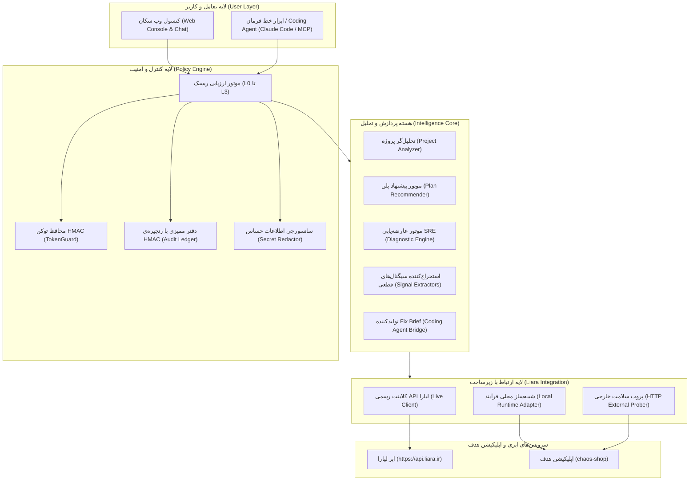

# مستندات معماری پلتفرم «سُکان» (Sokan Architecture Document)

> دستیار هوشمند استقرار، پایش SRE و عارضه‌یابی ابری لیارا  
> ارائه‌شده برای چالش هکاتون محصول هوش مصنوعی لیارا (تیم استارکوچ)

---

## ۱. نمای کلی و معماری سیستم (System Architecture)

«سُکان» به عنوان یک همکار مستقل DevOps و SRE طراحی شده است تا فاصله‌ی میان توسعه‌دهنده‌ای که دانشی از سرور و زیرساخت ندارد را با پیچیدگی‌های استقرار، تنظیم متغیرها، پایش سلامت و رفع خطاهای پس از انتشار پر کند.

### نمودار اجزای سیستم (Component Architecture)



### اجزای اصلی مخزن و پکیج‌ها:
- `packages/contracts`: تعاریف مشترک داده، کارت‌های تأیید (§۱۲.۲)، مدل حادثه Incident و FixBrief (§۱۱).
- `packages/policy`: پیاده‌سازی سطوح ریسک (L0..L3)، صدور و راستی‌آزمایی توکن HMAC گره‌خورده به پارامترها، زنجیره‌ی HMAC ممیزی (`AuditLedger`) و حذف اطلاعات حساس (`SecretRedactor`). ممیزی با `SOKAN_SECRET` در فایل JSONL پایدار می‌ماند و `audit.head` طول زنجیره را نگه می‌دارد؛ بدون کلید، ممیزی فقط در حافظه است و پس از ری‌استارت از بین می‌رود. اگر فایل دستکاری شده باشد، کنسول هشدار می‌دهد.
- `packages/analyzer`: تحلیل استاتیک پلتفرم (Node, Next, Python, PHP, Go, Docker)، شناسایی متغیرهای ضروری از کد، تشخیص پورت و پکیج‌ها، و الگوریتم پیشنهاد سه پلن (اقتصادی، پیشنهادی، مقیاس‌پذیر) با محاسبه نرخ ماهانه (`ساعتی × 720`).
- `packages/diagnostics`: پارسر لاگ و stack trace، استخراج سیگنال‌های قطعی خرابی، سیستم ارزیابی فرضیه‌ها، کاتالوگ Runbook و راستی‌آزمایی قبل و بعد. راستی‌آزمایی در executor به کار می‌رود و نتیجه‌ی `resolved`، `mitigated` (ری‌استارت نشت حافظه) یا `unresolved` می‌دهد.
- `packages/liara-client`: کلاینت تایپ‌شده روی OpenAPI رسمی و کدهای CLI با تبدیل کدهای HTTP (۴۰۱، ۴۰۲، ۴۰۳، ۴۰۴، ۴۰۹، ۴۱۳، ۴۲۸ و ۴۲۹) به راهنمای سه‌بخشی انسانی (چه شد / چرا / حالا چه کنیم).
- `packages/llm`: کلاینت مدل زبانی سازگار با OpenAI، ارکستریتور tool-calling روی رجیستری ابزارها و مسیریاب قاعده‌محور. گفت‌وگوی کنسول با `SOKAN_LLM_API_KEY` از مدل استفاده می‌کند؛ بدون کلید، مسیریاب قاعده‌محور پاسخ می‌دهد.
- `packages/mcp`: سرور MCP روی stdio برای Coding Agentها. با توکن عامل (`SOKAN_AGENT_TOKEN`، چاپ‌شده در کنسول و در `.sokan/agent-token`) به کنسول وصل می‌شود. ابزارهای L2 و L3 فقط درخواست تأیید می‌سازند؛ توکن عامل نمی‌تواند تأیید یا تغییری انجام دهد (allowlist در `apps/web/lib/http.js`).
- `apps/web`: کنسول وب فارسی، سرور SSE برای استریم لاگ و رویدادها، و کارت‌های تأیید. احراز هویت کنسول (توکن، کوکی HttpOnly، هدر CSRF و بررسی Host) پیاده شده است. اقدامات کنسول در حالت زنده از کلاینت لیارا استفاده می‌کنند، اما در این مخزن فقط در حالت شبیه‌سازی آزمایش شده‌اند؛ آزمایش روی حساب لیارای واقعی هنوز انجام نشده است.
- `demo/chaos-shop`: اپلیکیشن هدف دمو با شش خرابی شبیه‌سازی‌شده (deploy، ۵۰۰، نشت حافظه، CPU، کندی بالادست، پورت اشتباه) و سه سناریوی کمکی (`scenario-reset`، `scenario-tamper-test`، `scenario-injection`).

---

## ۲. نحوه اتصال به APIهای لیارا (Liara API Integration)

اتصال سُکان به لیارا بر پایه‌ی دو مرجع رسمی توسعه یافته است:
1. مشخصات رسمی OpenAPI لیارا (`knowledge/sources/openapi/spec/`)
2. کلاینت متن‌باز رسمی CLI لیارا (`knowledge/sources/cli/`) برای اندپوینت‌های عملیاتی نسخه ۲

### جدول نگاشت اندپوینت‌های کلیدی:

| حوزه عملیاتی | متد و مسیر | منبع | رفتار سُکان |
|---|---|---|---|
| **حساب و موجودی** | `GET /v1/me`<br>`GET /v1/billing` | OAS | خواندن مشخصات، کاتالوگ پلن‌ها (`plans.projects`) و موجودی ریالی (`balance`) |
| **ایجاد برنامه** | `POST /v1/projects` | OAS+CLI | ارسال نام، پلتفرم، شناسه پلن و باندل |
| **تغییر منابع** | `POST /v1/projects/{name}/resize` | OAS | ارتقا یا تنزل پلن سخت‌افزاری بر اساس نیاز |
| **متغیرهای محیطی** | `POST /v1/projects/update-envs` | OAS | تنظیم ایمن کلیدها با `{ project, variables: [{key, value}] }` |
| **آپلود سورس** | `POST /v2/projects/{name}/sources` | OAS+CLI | ساخت آرشیو `.tar.gz` (با حذف `node_modules` و فایل‌های محرمانه) تا سقف ۲۵۶ مگابایت |
| **ایجاد ریلیز** | `POST /v2/projects/{name}/releases` | OAS+CLI | استقرار سورس با اعلام پورت، نوع پلتفرم، تنظیمات بیلد و healthCheck |
| **استریم لاگ بیلد** | `GET /v2/releases/{id}/build-logs?since=` | CLI | نظارت بر ۴ مرحله: `ساخت ➔ ارسال ایمیج ➔ استقرار ➔ آماده` |
| **لاگ‌های زنده** | `GET /v1/projects/{name}/logs?since=` | OAS | استعلام لاگ‌ها (مسیر v1 مطابق OAS است و باید در تست زنده تأیید شود؛ CLI از مسیر v2 استفاده می‌کند) |
| **مشاهده‌پذیری** | `GET /v1/projects/{name}/applets`<br>`GET /v1/projects/{name}/metrics/summary` | OAS | استخراج وضعیت کانتینرها، تعداد ری‌استارت‌ها و درصد مصرف رم/پردازنده |

### دوگانگی اتصال (Dual Runtime Switch):
- **حالت ابری زنده (Live Cloud):** در صورت تعریف متغیر محیطی `LIARA_API_TOKEN`، کلاینت درخواست‌ها را به سرورهای `https://api.liara.ir` (و `https://dns-service.liara.ir` برای DNS) می‌فرستد. بدون توکن، کلاینت درخواستی نمی‌فرستد. اقدامات کنسول از همین کلاینت استفاده می‌کنند؛ روی حساب واقعی هنوز آزمایش نشده‌اند.
- **حالت شبیه‌ساز محلی (Local Simulation):** در غیاب توکن یا هنگام اجرای سناریوهای تکرارپذیر دمو، سُکان کانتینر محلی `chaos-shop` را مدیریت کرده، لاگ‌های واقعی فرآیند را دریافت نموده و پروب‌های زنده‌ی HTTP ارسال می‌کند؛ در عین حال وضعیت شبیه‌سازی در رابط کاربری به صورت شفاف به کاربر اطلاع داده می‌شود.

---

## ۳. محدودیت‌های شفاف راهکار (Transparent Boundaries & API Limits)

طبق اصل شفافیت وایت‌پیپر (§۱۳)، سُکان مرزهای خود را مشخص کرده و در مواردی که خارج از دسترس API است، به جای پنهان‌کاری، کاربر را با چک‌لیست و راهنمای گام‌به‌گام هدایت می‌کند:

1. **عملیات مالی و شارژ حساب:** به دلایل امنیتی و لزوم اتصال به درگاه بانکی شبکه شتاب، سُکان به اطلاعات کارت بانکی دسترسی ندارد. سُکان کسری اعتبار را محاسبه کرده، لینک پنل مالی لیارا را ارائه می‌دهد و پس از تأیید شارژ توسط کاربر ادامه می‌دهد.
2. **تغییر سرورهای نام در سامانه ایرنیک (nic.ir):** ایرنیک API عمومی جهت تغییر خودکار رکوردهای NS ندارد. سُکان رکوردهای موردنیاز لیارا را نشان می‌دهد تا کاربر در پنل nic.ir کپی کند، و وضعیت انتشار NS را با بررسی Zone در سرویس DNS لیارا می‌سنجد. پایش زمان‌بندی‌شده‌ی این وضعیت هنوز ساخته نشده است.
3. **متریک‌های سطح درخواست (Request-level Latency):** APIهای زیرساختی لیارا فقط مصرف رم و سی‌پی‌یو را می‌دهند. سُکان از **پروب HTTP مستقل** (`httpProbe`) و **تحلیل لاگ‌های دسترسی** استفاده می‌کند. صدک ۹۵ زمان پاسخ از نمونه‌های پروب محاسبه می‌شود؛ نرخ خطا از خطوط خطای لاگ و پاسخ‌های ۵xx پروب و لاگ دسترسی به‌دست می‌آید. این‌ها متریک سطح درخواست لیارا نیستند.
4. **پایش و هشدار:** کنسول هر ۳ ثانیه `/health` و مسیرهای پایش را برای نمایش وضعیت می‌سنجد. حادثه فقط با درخواست کاربر («سایتم مشکل داره» یا `sokan fix`) باز می‌شود. پایش زمان‌بندی‌شده‌ی حادثه، هشدار بیرونی و Webhook وجود ندارد.

---

## ۴. مدل تعامل کاربر و Human-in-the-Loop (HITL)

پایداری و امنیت سیستم تضمین می‌کند که هیچ اقدام پرریسکی بدون اجازه صریح کاربر اجرا نشود.

### تفکیک سطوح ریسک:
- **L0 (مشاهده):** خودکار و بدون اعلان (خواندن لاگ‌ها، دریافت متریک‌ها، وضعیت سرویس).
- **L1 (ایمن و برگشت‌پذیر):** خودکار + نمایش در تایم‌لاین رویدادها (آپلود سورس، گرفتن بکاپ از دیتابیس).
- **L2 (حساس):** نیازمند **کارت تأیید** و صدور توکن امضاشده‌ی سرور (تغییر پلن، ری‌استارت، دیپلوی، تنظیم متغیرها).
- **L3 (بحرانی):** نیازمند **تأیید دو مرحله‌ای** شامل تایپ نام دقیق برنامه + فعال شدن پنجره ۱۰ ثانیه‌ای لغو (حذف اپ، خاموش کردن کامل سرویس).

### ساختار کارت تأیید (§۱۲.۲):
هر پیشنهاد دارای ۶ فیلد استاندارد است:
1. **چه کاری:** عملیات فنی به زبان فارسی روان.
2. **چرا:** استناد به شواهد استخراج‌شده (مثلاً تعداد خطاهای لاگ یا اوج مصرف حافظه).
3. **هزینه:** مبلغ تغییر پلن به تومان یا «بدون هزینه».
4. **اثر:** مدت زمان دان‌تایم یا ری‌استارت احتمالی.
5. **بازگشت:** نحوه‌ی بازگشت به وضعیت قبل.
6. **معیار موفقیت:** شرط راستی‌آزمایی پس از اجرا (مانند بازگشت کد ۲۰۰ به پروب و پایداری رم).

---

## ۵. راهنمای راه‌اندازی و اجرای دمو (Quickstart)

### پیش‌نیازها:
- Node.js نسخه 20 یا بالاتر (توصیه: ۲۲)
- دسترسی به شل سیستم‌عامل (PowerShell در ویندوز یا Bash در لینوکس/مک)

### دستورات راه‌اندازی:

```bash
# ۱. نصب وابستگی‌های توسعه
npm install

# ۲. بیلد پکیج‌های تایپ‌اسکریپت و اجرای تست‌های خودکار
npm test

# ۳. اجرای کنسول وب و دستیار سُکان
npm start
```

پس از اجرای دستور فوق:
- **کنسول وب سُکان:** روی `127.0.0.1:4000` گوش می‌دهد (پورت با `SOKAN_PORT` قابل تغییر است). سُکان آدرسی مانند `http://127.0.0.1:4000/?t=<token>` چاپ می‌کند؛ همین آدرس را با توکن باز کنید. اگر `SOKAN_CONSOLE_TOKEN` تنظیم نشده باشد، توکن تصادفی است و با هر اجرا عوض می‌شود.
- **اپلیکیشن هدف دمو (chaos-shop):** روی پورت `3100` (متغیر `CHAOS_PORT`) اجرا می‌شود. در حالت شبیه‌سازی، سُکان آن را خودکار راه‌اندازی می‌کند.
- **حالت زنده:** با تنظیم `LIARA_API_TOKEN` و `SOKAN_APP` فعال می‌شود. فهرست متغیرها در `.env.example` است. سرور کنسول فایل `.env` مخزن سُکان را خودکار نمی‌خواند؛ در مقابل، CLI و کنسول ساده فایل `.env` پوشه‌ی پروژه‌ی کاربر را برای فهرست متغیرها می‌خوانند.
- **وضعیت:** bind پیش‌فرض روی `127.0.0.1` است و احراز هویت کنسول فعال است. اقدامات زنده روی حساب لیارا هنوز آزمایش نشده‌اند. جزئیات در [README](../README.md) و [ماتریس API](../packages/liara-client/docs/api-matrix.md) است.
